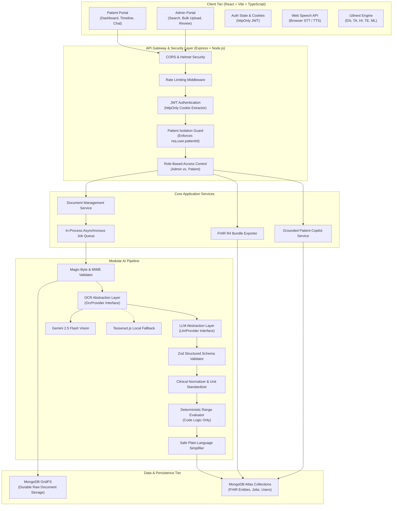
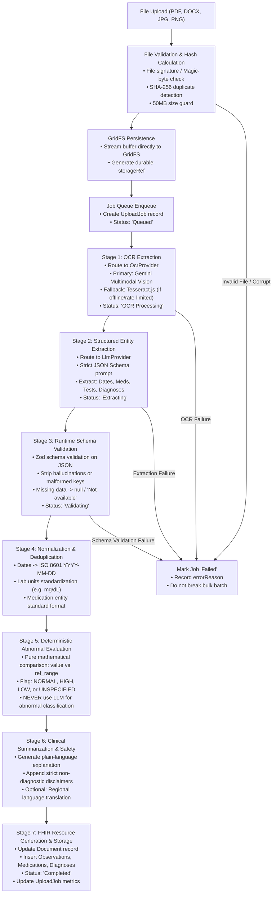
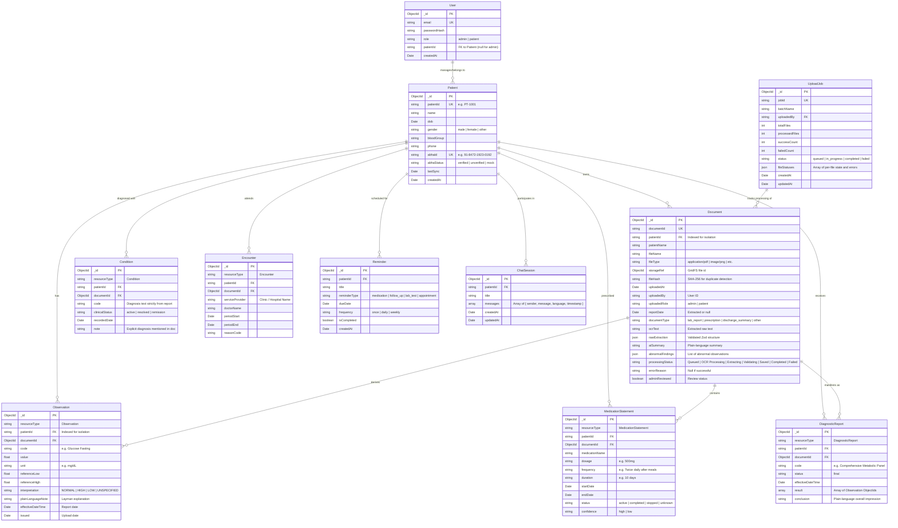

# System & Technical Architecture Specification

## 1. High-Level System Architecture

The AI-Powered Personal Health Copilot employs a decoupled, modular client-server architecture built entirely with TypeScript to guarantee end-to-end type safety. The client is a responsive Single Page Application (SPA), while the backend is an Express-based REST API enforcing strict isolation, asynchronous processing, and modular AI integrations.



---

## 2. End-to-End Medical Document Data Pipeline

The pipeline processes single files or high-volume bulk batches. Each stage is decoupled and executes as a discrete service with structured input/output contracts.



---

## 3. Database Schema & Entity Relationships (ER Diagram)

The data model uses a FHIR R4-inspired relational-on-document design in MongoDB. Every clinical resource incorporates a `resourceType` property, matching the HL7 FHIR standard while optimizing for fast MongoDB indexing and tenant isolation.



---

## 4. Key Design Patterns & Technical Specifications

### 4.1 Swappable AI & OCR Provider Abstraction
To prevent tight coupling to any proprietary LLM or OCR API, the extraction engine operates strictly against TypeScript interfaces:

```typescript
// Core abstraction interfaces
export interface OcrResult {
  rawText: string;
  confidence: number;
  detectedLanguage?: string;
  isHandwritten?: boolean;
}

export interface OcrProvider {
  name: string;
  extractText(fileBuffer: Buffer, mimeType: string): Promise<OcrResult>;
}

export interface MedicalEntityExtraction {
  patientName: string | null;
  patientIdHint: string | null;
  reportDate: string | null; // ISO 8601 YYYY-MM-DD
  documentType: 'lab_report' | 'prescription' | 'discharge_summary' | 'other';
  medicines: Array<{
    name: string;
    dosage: string | null;
    frequency: string | null;
    duration: string | null;
    instructions: string | null;
    confidence: 'high' | 'low';
  }>;
  tests: Array<{
    name: string;
    value: number | string;
    unit: string | null;
    referenceRange: {
      low: number | null;
      high: number | null;
      rawText: string | null;
    } | null;
  }>;
  explicitDiagnoses: string[];
  clinicalImpression: string | null;
}

export interface LlmProvider {
  name: string;
  extractEntities(ocrText: string, imageBuffer?: Buffer): Promise<MedicalEntityExtraction>;
  generatePlainSummary(extraction: MedicalEntityExtraction, language: string): Promise<string>;
  answerPatientQuery(context: string, query: string, language: string): Promise<string>;
}
```

### 4.2 Deterministic Abnormal Test Evaluation Logic
To ensure patient safety and eliminate LLM hallucination in clinical classification, test evaluation runs strictly as deterministic TypeScript code:

```typescript
export type Interpretation = 'NORMAL' | 'HIGH' | 'LOW' | 'UNSPECIFIED';

export function evaluateTestValue(
  value: number | string,
  referenceRange?: { low: number | null; high: number | null } | null
): Interpretation {
  if (!referenceRange || (referenceRange.low === null && referenceRange.high === null)) {
    return 'UNSPECIFIED'; // Do NOT flag without a report-printed reference interval
  }

  const numVal = typeof value === 'number' ? value : parseFloat(String(value));
  if (isNaN(numVal)) {
    return 'UNSPECIFIED';
  }

  if (referenceRange.low !== null && numVal < referenceRange.low) {
    return 'LOW';
  }
  if (referenceRange.high !== null && numVal > referenceRange.high) {
    return 'HIGH';
  }

  return 'NORMAL';
}
```

### 4.3 FHIR R4 Bundle Exporter (`toFhirBundle`)
ABDM compliance is achieved through an internal resource mapper that formats patient records into an HL7 FHIR R4 JSON Bundle (`type: 'collection'`):

```typescript
export async function toFhirBundle(patientId: string): Promise<FhirBundle> {
  const patient = await PatientModel.findOne({ patientId });
  const observations = await ObservationModel.find({ patientId });
  const medications = await MedicationStatementModel.find({ patientId });
  const reports = await DiagnosticReportModel.find({ patientId });

  return {
    resourceType: 'Bundle',
    type: 'collection',
    timestamp: new Date().toISOString(),
    entry: [
      { resource: mapToFhirPatient(patient) },
      ...observations.map(obs => ({ resource: mapToFhirObservation(obs) })),
      ...medications.map(med => ({ resource: mapToFhirMedicationStatement(med) })),
      ...reports.map(rep => ({ resource: mapToFhirDiagnosticReport(rep) })),
    ],
  };
}
```

### 4.4 Tenant Isolation & Security Architecture
1. **Authentication:** 
   - Handled via signed JSON Web Tokens (JWT) containing `{ userId, role, patientId }`.
   - Delivered exclusively in `httpOnly`, `secure`, `sameSite: 'strict'` HTTP cookies to eliminate XSS token theft.
2. **Tenant Isolation Middleware:**
   - Any endpoint with a `:patientId` parameter or patient-facing resource route injects a mandatory validation guard:
   ```typescript
   export const enforcePatientIsolation = (req: Request, res: Response, next: NextFunction) => {
     if (req.user.role === 'admin') return next();
     
     // Patients are hard-locked to their own ID
     const targetId = req.params.patientId || req.query.patientId || req.body.patientId;
     if (targetId && targetId !== req.user.patientId) {
       return res.status(403).json({ error: 'Access denied: Tenant isolation violation.' });
     }
     
     // Automatically scope queries to the authenticated user
     req.scopedPatientId = req.user.patientId;
     next();
   };
   ```
3. **Storage Security:**
   - Files are stored in MongoDB GridFS, keeping raw binaries isolated from public web directories.
   - Access to raw files is restricted to authenticated users matching document ownership.
4. **Log Sanitization:**
   - Custom Winston/Pino logger masks patient names, phone numbers, ABHA IDs, and API keys.
